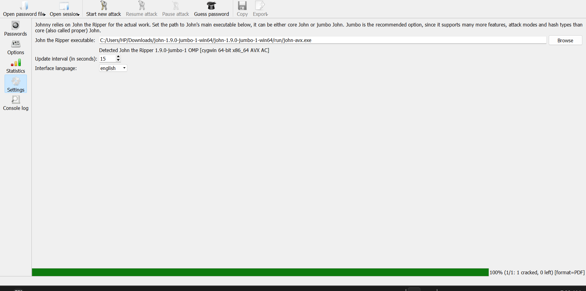
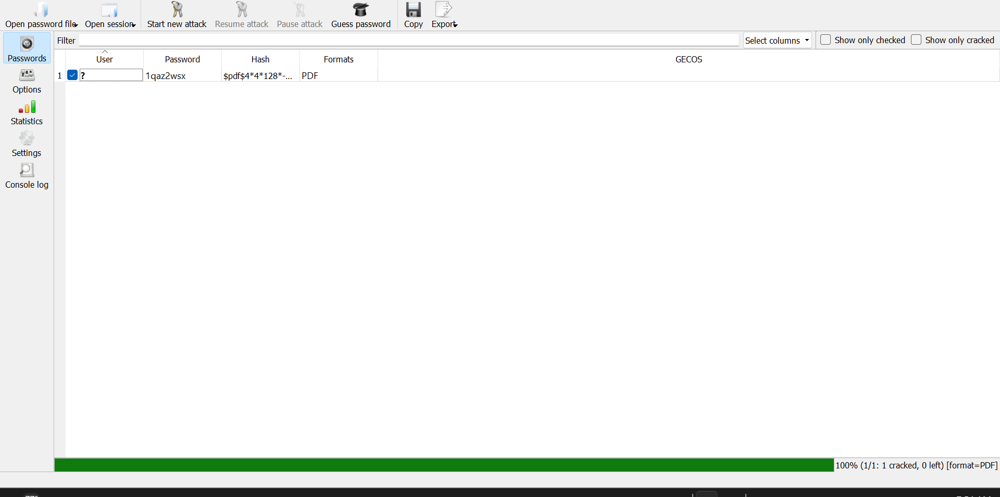
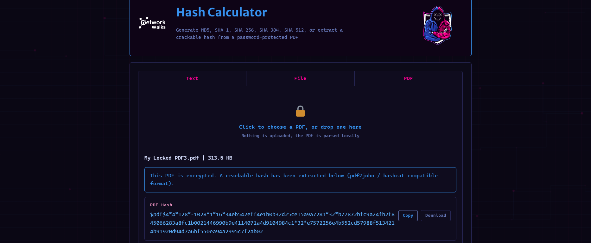
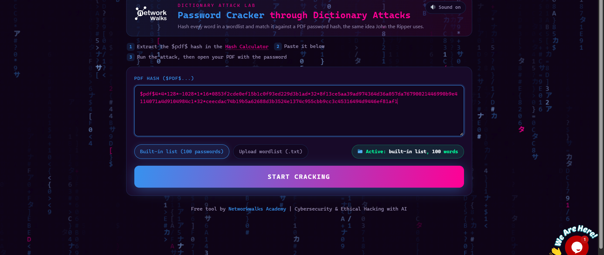
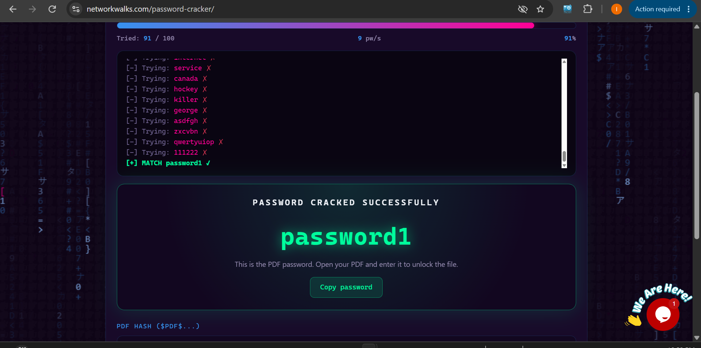
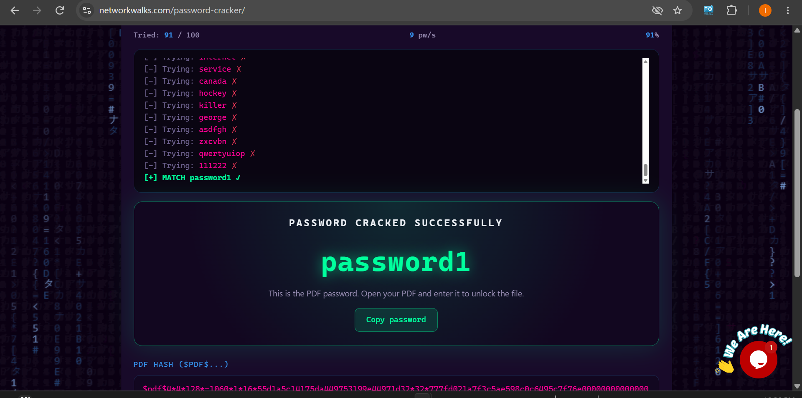
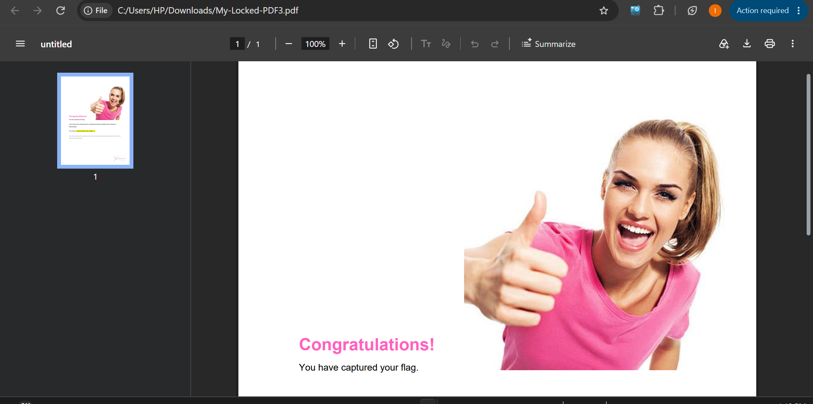
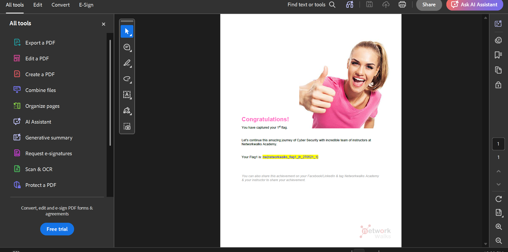

# Password Cracking Lab — John the Ripper & NetworkWalks Tools

**NetworkWalks Cybersecurity Internship — Week 3 | B084 | PM3–PM5**

This lab documents password recovery for sample, password-protected PDF files using John the Ripper (JtR), its Johnny graphical interface, and NetworkWalks' browser-based hash and password-cracking tools.

> **Authorized use only:** Perform these techniques only on files you own or have explicit permission to assess. The exercise described here uses sample files supplied for training. Do not publish recovered passwords or sensitive hashes.

## Objectives

- Extract a PDF password hash in a format supported by PDF password-recovery tools.
- Load the hash into John the Ripper and run a wordlist-based audit.
- Use NetworkWalks' Hash Calculator and Password Cracker to understand the browser-based workflow.
- Verify the result by opening the sample PDF with the recovered password.
- Compare the desktop and browser-based workflows and document the security lessons.

## Tools

| Tool | Purpose |
|---|---|
| John the Ripper (JtR) | Password-auditing engine |
| Johnny | Graphical interface for John the Ripper |
| NetworkWalks Hash Calculator | Extracts a test PDF hash |
| NetworkWalks Password Cracker | Tests candidate passwords against a supplied hash |
| Wordlist | Supplies candidate passwords for a dictionary audit |

## Lab workflow

### PM3 — John the Ripper / Johnny

1. Configure Johnny to use the John the Ripper executable.
2. Extract the hash from an authorized sample PDF using a compatible PDF hash-extraction workflow.
3. Load the extracted hash into Johnny.
4. Run a controlled dictionary audit with the lab wordlist.
5. Verify the result by opening the sample PDF. Keep any recovered password private; redact it from screenshots and reports.

### PM4 — NetworkWalks Hash Calculator

1. Open the NetworkWalks Hash Calculator.
2. Select an authorized training PDF.
3. Extract the PDF hash using the calculator.
4. Treat the output as sensitive: do not commit real hashes or credentials to a public repository.

### PM5 — NetworkWalks Password Cracker

1. Use the hash produced from the training PDF.
2. Submit it to the NetworkWalks Password Cracker with the supplied training wordlist.
3. Review the audit result and record whether a match was found, without publishing the password.
4. Validate the recovered password against the sample PDF, where applicable.

## Screenshots

All images are stored in the repository root. The links below use exact, case-sensitive filenames so GitHub can render them directly.

### John the Ripper / Johnny

### NetworkWalks tools

### PDF verification

---

## Results

The following outcomes are taken from the lab screenshots:

| Activity | Tool | Outcome |
|---|---|---|
| PDF hash extraction | NetworkWalks Hash Calculator | Successfully extracted a PDF-compatible password hash from the sample file. |
| Dictionary audit | John the Ripper / Johnny | Successfully cracked the loaded PDF hash: **1 of 1 hashes recovered (100%)**. |
| Browser-based audit | NetworkWalks Password Cracker | **Match found after 91 of 100 candidates (91%)**, at approximately **9 passwords/second**. |
| PDF verification | PDF reader | Successfully opened the protected PDF and confirmed the lab's flag/verification message. |

## Key learnings

- Password-protected PDFs use cryptographic mechanisms that allow offline password auditing when the corresponding hash can be extracted.
- Dictionary attacks test candidate passwords; success depends heavily on password strength and the candidate list.
- A desktop tool such as JtR provides a local workflow, while browser-based tools offer a more guided interface.
- Long, unique passwords and strong PDF encryption materially increase resistance to guessing attacks.
- Hashes and recovered passwords should be handled as sensitive data and excluded from public commits.

## Safety and ethics

This is a controlled educational exercise. Only assess sample files or files for which you have explicit authorization. Do not use recovered credentials to access unrelated accounts, systems, or data.

## Author

**Abhishek Deepak**  
NetworkWalks Cybersecurity Internship — B084

## Project information

- **Program:** NetworkWalks Cybersecurity
- **Week:** 03
- **Modules:** PM3–PM5
- **Topic:** PDF password auditing with John the Ripper and NetworkWalks tools
